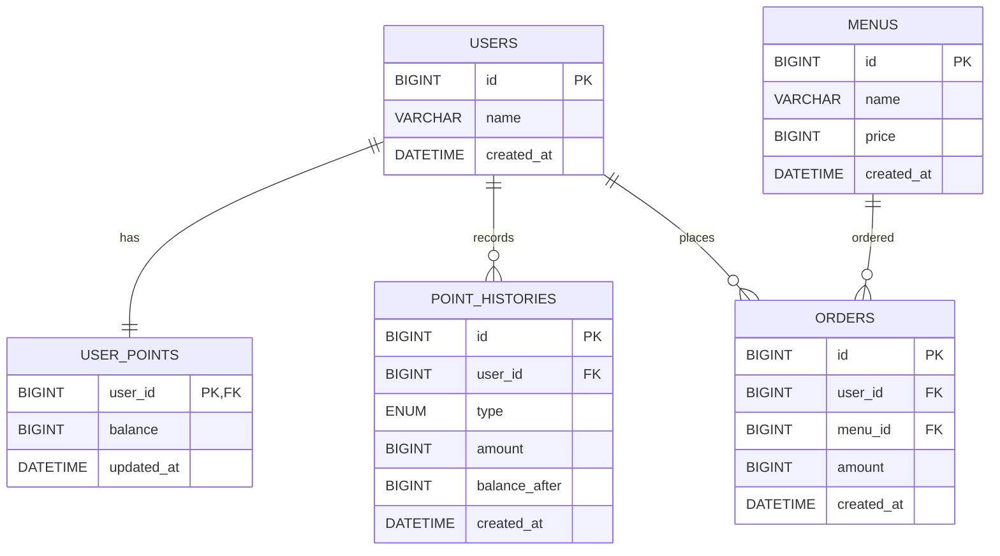
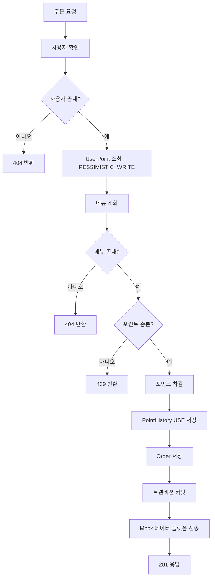

# Coffee Order System

## 1. 프로젝트 소개

다수 서버 환경에서도 안정적으로 동작할 수 있도록 설계한 커피숍 주문 시스템입니다.

과제 요구사항에 따라 다음 기능을 구현합니다.

- 커피 메뉴 목록 조회
- 포인트 충전
- 커피 주문 및 포인트 결제
- 최근 7일 인기 메뉴 TOP 3 조회
- 주문 내역 데이터 수집 플랫폼 실시간 전송
- 동시성 및 데이터 일관성 고려
- 핵심 기능 및 제약사항 테스트

이번 구현에서는 과제 제출에 필요한 범위에 집중하여 Redis, Kafka, 재고, 일별 통계 테이블 등은 제외합니다.

---

## 2. 요구사항 정리

### 필수 기능

1. 커피 메뉴 목록 조회
2. 포인트 충전
3. 커피 주문 및 결제
4. 인기 메뉴 TOP 3 조회
5. 주문 내역 데이터 수집 플랫폼 전송

### 도전 요구사항

- 다중 서버 / 다중 인스턴스 환경 고려
- 동시성 이슈 고려
- 데이터 일관성 고려
- 기능 및 제약사항 테스트 작성

---

## 3. ERD



### 설계 의도

#### users

사용자 식별을 담당합니다.

#### user_points

현재 사용 가능한 포인트 잔액을 저장합니다.

포인트를 `users`에서 분리한 이유는 주문과 충전 시 실제로 변경되고 동시성 제어가 필요한 데이터가 사용자 기본 정보가 아니라 포인트 잔액이기 때문입니다.

동일 사용자에 대한 충전/결제 요청이 동시에 발생할 경우 `user_points` 행을 대상으로 DB 비관적 락을 적용합니다.

#### point_histories

포인트의 충전 및 사용 내역을 기록합니다.

MySQL에서 `type`의 실제 타입은 `ENUM('CHARGE','USE')`입니다.

현재 잔액만 저장하면 잔액이 어떤 과정을 통해 만들어졌는지 추적하기 어렵기 때문에 포인트 변경 이력을 별도 테이블로 관리합니다.

예:

```text
CHARGE +10,000 -> 10,000
USE     -4,500 -> 5,500
```

#### menus

메뉴 이름과 가격을 관리합니다.

#### orders

사용자 주문 내역을 저장합니다.

과제 요구사항은 한 번의 주문 요청에서 사용자 식별값과 메뉴 ID 하나를 입력받도록 되어 있으므로 `order_items` 테이블은 별도로 만들지 않았습니다.

`amount`에는 주문 당시 메뉴 가격을 저장하여 이후 메뉴 가격이 변경되더라도 과거 결제 금액이 바뀌지 않도록 합니다.

---

## 4. API 명세

### 4.1 커피 메뉴 목록 조회

`GET /api/menus`

#### Response 200

```json
[
  {
    "menuId": 1,
    "name": "아메리카노",
    "price": 4500
  }
]
```

---

### 4.2 포인트 충전

`POST /api/users/{userId}/points`

#### Request

```json
{
  "amount": 10000
}
```

#### Response 200

```json
{
  "userId": 1,
  "balance": 15000
}
```

#### 처리

1. 사용자 존재 확인
2. `user_points` 비관적 락 조회
3. 포인트 증가
4. `point_histories`에 `CHARGE` 기록
5. 트랜잭션 커밋

#### 예외

- 사용자가 존재하지 않는 경우: `404`
- 충전 금액이 0 이하인 경우: `400`

---

### 4.3 커피 주문 / 결제

`POST /api/orders`

#### Request

```json
{
  "userId": 1,
  "menuId": 1
}
```

#### Response 201

```json
{
  "orderId": 1,
  "menuId": 1,
  "menuName": "아메리카노",
  "amount": 4500,
  "remainingPoint": 5500
}
```

#### 처리

1. 사용자 확인
2. `user_points` 비관적 락 조회
3. 메뉴 조회
4. 포인트 충분 여부 확인
5. 포인트 차감
6. `point_histories`에 `USE` 기록
7. 주문 저장
8. 트랜잭션 커밋
9. Mock 데이터 수집 플랫폼 전송

#### 예외

- 사용자가 존재하지 않는 경우: `404`
- 메뉴가 존재하지 않는 경우: `404`
- 보유 포인트가 부족한 경우: `409`

---

### 4.4 인기 메뉴 TOP 3 조회

`GET /api/menus/popular`

최근 7일 동안 주문 횟수가 많은 메뉴 3개를 반환합니다.

#### Response 200

```json
[
  {
    "menuId": 1,
    "name": "아메리카노",
    "orderCount": 20
  },
  {
    "menuId": 3,
    "name": "바닐라라떼",
    "orderCount": 15
  },
  {
    "menuId": 2,
    "name": "카페라떼",
    "orderCount": 12
  }
]
```

#### 집계 기준

- 조회 시점 기준 최근 7일
- `orders` 원본 데이터를 기준으로 집계
- `menu_id` 기준 GROUP BY
- COUNT 결과 내림차순
- 상위 3개

---

## 5. 주문 처리 흐름



---

## 6. 문제 해결 전략

### 6.1 포인트를 사용자에서 분리한 이유

사용자의 이름 등 기본 정보와 포인트 잔액은 변경 특성이 다릅니다.

주문과 충전에서 동시 변경되는 데이터는 포인트이므로 이를 `user_points`로 분리해 동시성 제어 대상을 명확히 했습니다.

### 6.2 포인트 이력 테이블을 둔 이유

잔액만 관리하면 충전과 사용 과정을 추적하기 어렵습니다.

따라서 `point_histories`에 다음 값을 저장합니다.

- 변경 종류: `CHARGE`, `USE`
- 변경 금액
- 변경 직후 잔액
- 생성 시각

이를 통해 데이터 검증과 트러블슈팅이 쉬워집니다.

### 6.3 동시성 문제

동일 사용자가 동시에 여러 주문을 요청하면 두 요청이 같은 잔액을 보고 모두 결제 가능하다고 판단할 수 있습니다.

이를 방지하기 위해 `user_points` 조회 시 DB 비관적 락을 적용합니다.

### 6.4 비관적 락 선택 이유

Java의 `synchronized`와 `ReentrantLock`은 하나의 JVM 안에서만 동작합니다.

과제에서는 다수 서버 / 다수 인스턴스 환경에서도 정상 동작해야 하므로, 모든 인스턴스가 공유하는 DB를 기준으로 락을 적용합니다.

### 6.5 데이터 일관성

포인트 충전:

- 포인트 증가
- 포인트 이력 저장

주문/결제:

- 포인트 검증
- 포인트 차감
- 포인트 사용 이력 저장
- 주문 저장

위 작업을 각각 하나의 트랜잭션으로 처리합니다.

중간에 오류가 발생하면 전체 작업이 롤백되도록 합니다.

### 6.6 인기 메뉴 정확성

인기 메뉴는 별도의 캐시/통계 테이블 없이 `orders` 원본을 직접 집계합니다.

과제에서 메뉴별 주문 횟수가 정확해야 한다고 요구하므로, 제출 범위에서는 원본 데이터 직접 집계를 선택했습니다.

### 6.7 데이터 수집 플랫폼 전송

과제에서는 Mock API 또는 테스트 코드를 허용하므로 실제 외부 인프라는 구축하지 않습니다.

`OrderDataPlatform` 인터페이스와 Mock 구현체를 두고 다음 값을 전송합니다.

- userId
- menuId
- paymentAmount

---

## 7. 기술 선택 이유

### Spring Boot + JPA

- 빠른 API 개발
- 트랜잭션 처리
- JPA 비관적 락 지원

### MySQL

- 트랜잭션 지원
- 행 단위 비관적 락 지원
- 다중 서버가 공유할 수 있는 저장소

### Pessimistic Lock

포인트처럼 동일 Row에 대한 동시 변경이 발생할 수 있는 데이터의 정합성을 단순하고 명확하게 보장하기 위해 선택했습니다.

### JPQL

최근 7일 주문을 메뉴별로 집계하는 기능에 사용합니다.

---

## 8. 제외한 기능

제출 범위를 벗어나거나 구현 복잡도를 크게 증가시키는 아래 기능은 제외했습니다.

- Redis
- Redisson 분산 락
- Kafka
- 메뉴 재고
- 주문 상태 전이
- 메뉴 일별 통계 테이블
- Idempotency Key
- 사용자 인증 / JWT
- 메뉴 등록 / 수정 / 삭제 API

---

## 9. 테스트 전략

### Menu

- 메뉴 목록 조회 성공

### Point

- 충전 성공
- 0 이하 충전 실패
- 사용자 없음
- 충전 후 PointHistory 생성

### Order

- 주문 성공
- 사용자 없음
- 메뉴 없음
- 포인트 부족
- 주문 성공 시 포인트 정상 차감
- PointHistory USE 생성
- 주문 당시 가격 저장

### Concurrency

- 동일 사용자 동시 주문 시 포인트 음수 방지
- 가능한 주문 수보다 많은 주문이 성공하지 않음

### Popular Menu

- 최근 7일 주문만 집계
- 주문 횟수 기준 내림차순
- 최대 3개 반환

---

## 10. 패키지 구조

```text
domain
├── user
│   ├── entity
│   └── repository
├── point
│   ├── controller
│   ├── dto
│   ├── entity
│   ├── repository
│   └── service
├── menu
│   ├── controller
│   ├── dto
│   ├── entity
│   ├── repository
│   └── service
└── order
    ├── controller
    ├── dto
    ├── entity
    ├── repository
    └── service

global
├── config
├── exception
└── external
```

---

## 11. 트러블슈팅

## 문제 1) 같은 사용자의 동시 주문으로 인한 포인트 정합성


### 문제 인식

보유 포인트가 4,000P이고 메뉴 가격이 4,000P일 때 주문 요청이 여러 개 동시에 도착한다고 가정했다.

```text
초기 잔액: 4,000P
메뉴 가격: 4,000P

요청 A → 잔액 4,000P 확인
요청 B → 잔액 4,000P 확인

잠금 없이 각각 결제 가능 여부를 판단하면
한 번만 가능한 결제가 중복 처리될 위험이 있다.
```

이 문제는 단순히 잔액이 음수가 되는 경우에만 해당하지 않는다. **주문이 두 건 생성되었는데 잔액 차감은 한 건만 반영되는 손실도 발생할 수 있다.

###  해결 방법

충전과 주문 모두 **동일한 `user_points` 행을 `PESSIMISTIC_WRITE`로 조회**하도록 구현했다. 포인트 검증·잔액 변경·이력 저장·주문 저장은 하나의 DB 트랜잭션에서 수행한다.

```java

@Lock(LockModeType.PESSIMISTIC_WRITE)
@Query("select p from UserPoint p where p.user.id = :userId")
Optional<UserPoint> findByUserIdWithLock(Long userId);
```

Java의 `synchronized` 같은 JVM 내부 잠금 대신 DB 행 잠금을 선택한 이유는 **다중 인스턴스가 같은 데이터베이스를 공유하는 환경**을 고려했기 때문이다. 사용자별로 잠금 대상 행이 나뉘므로 서로 다른 사용자의 포인트 변경은 동일한 한 행에 집중되지 않는다.

주문 트랜잭션은 다음 작업을 함께 처리한다.

1. 해당 사용자의 포인트 행을 잠금 조회
2. 메뉴 가격과 포인트 잔액 확인
3. 잔액 차감
4. `point_histories`에 `USE` 이력 저장
5. `orders`에 주문 저장

실패 시 포인트 차감만 반영되거나 주문만 저장되는 상황을 막기 위해 같은 트랜잭션에서 롤백한다. 포인트 충전도 **잔액 증가 + `CHARGE` 이력 저장**을 같은 트랜잭션으로 처리한다.

##  문제 2) 소수 입력이 정수로 변환되어 처리될 수 있었던 문제

### 문제 인식

기능을 구현한 뒤 제출 전 코드 점검에서 문제를 발견하였다. 충전 금액 및 주문 요청 ID를 `Long`으로 정의하고 `@Positive` 등을 적용했지만, 소수 JSON 숫자가 정수로 변환될 수 있었다.

```json
{
  "amount": 4500.5
}
```

요청 값 자체는 소수인데 내부에서 정수로 변환된 뒤 검증을 통과하면, **클라이언트가 요청한 금액과 실제 처리 금액이 달라질 수 있다.** 주문의 사용자 ID나 메뉴 ID도 같은 문제의 영향을 받을 수 있다.

### 수정 내용

- Jackson의 **소수 → 정수 자동 변환을 금지**했다.
- 충전 금액과 주문 요청의 사용자 ID·메뉴 ID에 소수가 입력되면 **HTTP 400**을 반환하도록 했다.
- 정상적인 정수 요청 및 기존 API URL·응답 형식은 유지했다.
- 소수 금액과 소수 ID 요청에 대한 테스트를 추가했다.
